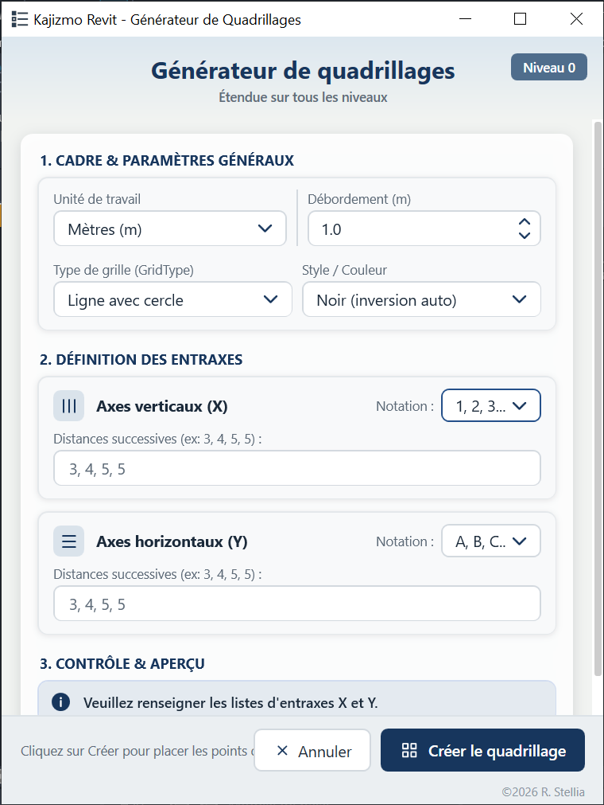

<div align="center">

# KAJIZMO REVIT

**Extension pyRevit pour Autodesk Revit — automatisation.**

[](https://github.com/vlax-rsr/KajizmoRevit-QuadrillageAuto/releases/latest)
[](https://github.com/vlax-rsr/KajizmoRevit-QuadrillageAuto/releases)
[](#prerequis)
[](#prerequis)
[](LICENSE)

[](#)
[](#)
[](#)
[](#)
[](#)

[Installation](#installation) · [Fonctionnalites](#fonctionnalites) · [Utilisation](#utilisation) · [Journal des modifications](CHANGELOG.md)

</div>

---

## Presentation

**Kajizmo Revit** est une extension [pyRevit](https://github.com/pyrevitlabs/pyRevit)
qui ajoute un onglet dedie dans le ruban d'Autodesk Revit.

**Tache realisee : automatisation.**

L'extension est **autonome** : elle ne depend d'aucun script externe pour fonctionner.
Le laboratoire de developpement (modules experimentaux) est conserve en local et
n'est pas publie dans le depot distant.

## Fonctionnalites

- **Automatisation quadrillage** (unique option actuellement disponible) — voir la
  section [Automatisation quadrillage](#automatisation-quadrillage).
- *(Autres fonctionnalites a venir.)*

## Automatisation quadrillage

Genere un reseau de quadrillages (grilles) orthogonaux dans Revit a partir d'une
liste d'espacements saisie par l'utilisateur. Le traitement est execute directement
par l'API Revit : le resultat est rapide.

### Fonctionnalites

- **Saisie par espacements** : entrez les distances successives entre les files
  verticales (X) et horizontales (Y). Valeurs separees par une virgule (`,`), un
  point-virgule (`;`) ou un espace.
- **Apercu en temps reel** : l'emprise totale et le nombre de files se mettent a
  jour pendant la saisie (par ex. `Emprise : 16.00 m x 18.00 m (5 x 5 files)`) ;
  une saisie invalide affiche un message et desactive la creation.
- **Notation au choix, par axe** : files numerotees (`1`, `2`, `3`, …) ou lettreees
  (`A`, `B`, `C`, …). Par defaut : axes verticaux numerotes, axes horizontaux
  lettres.
- **Unites** : metres (m), millimetres (mm) ou centimetres (cm).
- **Type de quadrillage** : reprend les types presents dans le modele, avec
  **Bulle 6.5mm** propose par defaut.
- **Couleur** : **Rouge**, **Noir** ou **Conserver la couleur actuelle**. La
  couleur des lignes est appliquee au type de quadrillage ainsi qu'aux extremites
  (bulles) du quadrillage.
- **Debordement des extremites** : marge reglable au-dela des extremites, au
  clavier ou avec les boutons **+ / -** (pas de 0,1 m / 1 cm / 10 mm selon
  l'unite choisie).
- **Creation intelligente** : quadrillage genere sur le niveau actif, etendu
  verticalement sur **tous les niveaux** et affiche en vue 3D.

### Apercu de l'interface

<div align="center">



</div>

### Utilisation

1. Ouvrez un projet Revit et placez-vous sur la vue du niveau souhaite. Une
   pastille dans la fenetre indique le niveau detecte.
2. Dans le ruban, cliquez sur l'onglet **Kajizmo Revit** → panneau **Quadrillage**
   → **Reseau de quadrillage**.
3. Renseignez les **distances entre files** pour les axes verticaux (X) et
   horizontaux (Y), puis reglez au besoin la notation, l'unite, le type de
   quadrillage, la couleur et le debordement (champ ou boutons + / -).
4. Verifiez l'apercu de l'emprise, puis validez avec **Entree** ou le bouton
   **Creer les quadrillages**.
5. Cliquez sur un point de la zone de dessin de la vue qui sera l'origine du quadrillage.

### Exemple

| Axe | Espacements saisis | Positions des axes (m) |
| :-- | :-- | :-- |
| X (vertical) | `3, 5, 4, 4` | 0 → 3 → 8 → 12 → 16 |
| Y (horizontal) | `4, 5, 5, 4` | 0 → 4 → 9 → 14 → 18 |

Dans cet exemple, l'emprise totale affichee est de **16.00 m x 18.00 m**
(5 x 5 files).

## Prerequis

| Element | Version |
| :-- | :-- |
| Autodesk Revit | 2019 ou version ulterieure |
| pyRevit | 4.8 ou version ulterieure (derniere version recommandee) |

> Non teste sur l'ensemble des versions de Revit.
>
> pyRevit **7.0.0 ou ulterieur** est recommande : les versions anterieures
> souffrent d'un ralentissement connu a l'execution des commandes pyRevit.

## Installation

### Option 1 — Telechargement de l'archive (recommande)

1. Telechargez et installez la derniere version de
   [pyRevit](https://github.com/pyrevitlabs/pyRevit/releases).
2. Telechargez la derniere archive :
   [**KajizmoRevit-1.0.0.rar**](https://github.com/vlax-rsr/KajizmoRevit-QuadrillageAuto/releases/latest/download/KajizmoRevit-1.0.0.rar)
   (ou consultez la page [Versions](https://github.com/vlax-rsr/KajizmoRevit-QuadrillageAuto/releases/latest)).
3. Decompressez l'archive (WinRAR, 7-Zip ou equivalent) : vous obtenez le dossier
   `KajizmoRevit.extension`.
4. Copiez ce dossier dans le repertoire des extensions pyRevit :
   - `%APPDATA%\pyRevit\Extensions`
   - soit en clair : `C:\Users\<votre-nom>\AppData\Roaming\pyRevit\Extensions`
5. Dans Revit, ouvrez l'onglet **pyRevit** → **Reload** (ou menu **pyRevit** →
   **Reload**).

> Le nom du dossier **doit** se terminer par `.extension`, sinon pyRevit ne le
> reconnait pas.

### Option 2 — Installation par Git

```powershell
cd "$env:APPDATA\pyRevit\Extensions"
git clone https://github.com/vlax-rsr/KajizmoRevit-QuadrillageAuto.git KajizmoRevit.extension
```

Pour mettre a jour une installation existante :

```powershell
cd "$env:APPDATA\pyRevit\Extensions\KajizmoRevit.extension"
git pull
```

### Rechargement

Apres toute installation ou mise a jour, rechargez pyRevit :

- Onglet **pyRevit** → **Reload**, ou
- en terminal : `pyrevit reload`

## Structure du depot

```text
KajizmoRevit.extension/
├── .gitattributes
├── .gitignore
├── LICENSE
├── CHANGELOG.md
├── README.md
├── apercu.png
└── Kajizmo Revit.tab/
    ├── Conception structurelle.panel/
    │   ├── quadrillageauto.pushbutton/
    │       ├── bundle.yaml
    │       ├── icon.png
    │       ├── icon.dark.png
    │       ├── ui.xaml
    │       └── script.py
    │   └── RemakeQuadrillage.pushbutton/
    ├── Architecture.panel/        (vide)
    └── Laboratoire.panel/         (local uniquement, non publie)
        ├── MursDepuisCAO.pushbutton/
        └── Placeholder Panel.panel/
```

## Contribution et assistance

- Pour signaler un bug ou proposer une amelioration, ouvrez une
  [issue](https://github.com/vlax-rsr/KajizmoRevit-QuadrillageAuto/issues).

## Tags

#BIM #automatisation #Revit #Structure #Architecture

## Licence

Distribue sous licence **MIT**. Voir le fichier [LICENSE](LICENSE).
